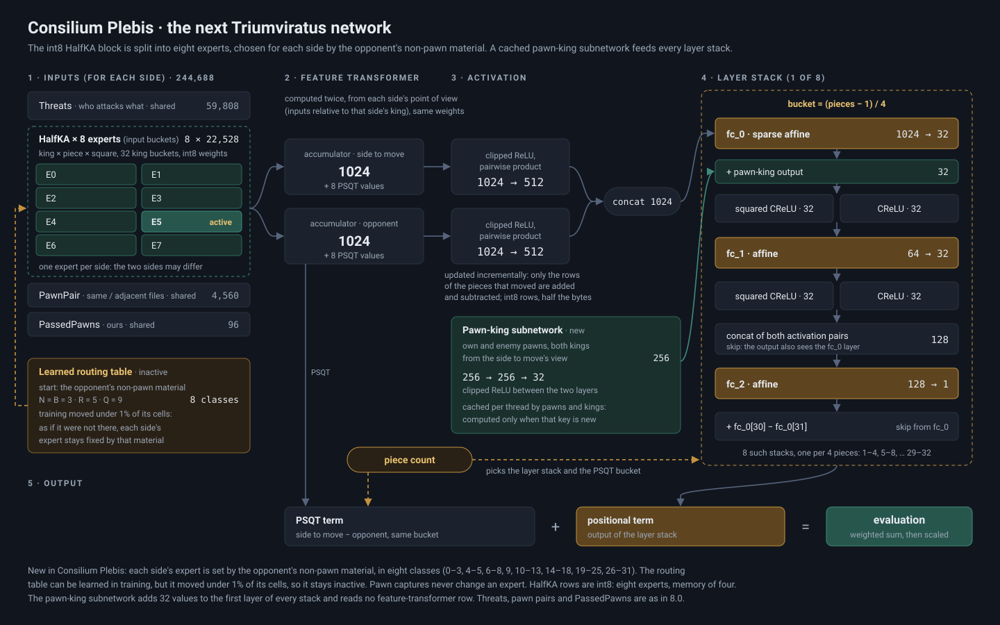

# Consilium Plebis: the network of Triumviratus 8.1 (21-28/10/2026)

**File:** `nn-consilium-plebis.nnue`, the file name the 8.1 engine loads by default, attached to the release
[`consilium-plebis`](https://github.com/Tors3/Triumviratus-Networks/releases/tag/consilium-plebis) (255.7 MB, SHA-256
`b069fc089421bdf2dfcc5d7ea4de2345d7af4795cd996373c07d5f5cf67e0670`) together with its float weights for fine-tuning.
**Strength:** against the final Consilium (the 8.0 network), same search on both sides at 30k nodes per move,
**+10.3 +- 4.3 Elo** over 8,332 games (SPRT [0, 3] passed, 28/10/2026); against the end of its own pretraining (P,
epoch 496) +0.7 +- 2.8 over 18,332 games.

**Name (author, 22/10/2026): Consilium Plebis**, "the council of the plebs", after the Concilium Plebis of the Roman
Republic: the plebs are the pawns, which in this network have a subnetwork of their own with the two kings. It was
developed as Consilium-2; the folder, the file names (`consilium2_*`, `c2_P_epNN.nnue`; the default network file was `nn-consilium2.nnue` until 28/10/2026, now `nn-consilium-plebis.nnue`), the
engine flag `TRIUMV_C2` and the engine options `C2*` keep that short form.

Design and measurements: [`docs/DESIGN_NEXT_NETWORK_2026-10-21.md`](docs/DESIGN_NEXT_NETWORK_2026-10-21.md). Frozen
specification for trainer, run and engine: [`docs/ARCHITECTURE_2026-10-21.md`](docs/ARCHITECTURE_2026-10-21.md).
Run log: [`LOG_RUN.md`](LOG_RUN.md). Training data: [`DATA.md`](DATA.md). Charts: [`charts/`](charts/).

**Status (28/10/2026):** pretraining P ran from 21/10 02:21 UTC on 2x RTX 4090 and was stopped by the author after
epoch 496 of the planned 550 (27/10 00:14 UTC, training loss 0.00311, LR 3.7% of its peak). The finetune F started
from those weights at 00:15 UTC with the author's piecewise LR schedule (below); at 08:22 UTC the flat stretch was
cut from 20 to 10 epochs, and F ended after 60 epochs at 15:20 UTC (training loss 0.003082, 0.74% below P's epoch 496;
on the t91 holdout 0.14% above it at lambda 0.75, `LOG_RUN.md`). A second cycle from F's end and a restart at 0.5% of
P's peak gave worse networks and were deleted on the author's order. **Final network (28/10/2026):** F continued
for 3 epochs from its final LR down to zero, weights averaged over those 3 epochs (`FR3_avg3_step240282.nnue`).
Against P's epoch 496 at 30k nodes it scored +0.57 +- 3.65 over 10,974 games, the final F +0.99 +- 4.41 over 7,358:
together +0.7 +- 2.8, level or slightly above. The published file is that average with its feature transformer
permuted on 2,000,000 positions (same evaluation, bench 245702 with the adopted margins as the unpermuted file).
Against the final Consilium at 30k nodes: +10.3 +- 4.3 over 8,332 games. Run logs, metrics and md5 sums of the final
networks:
[`run_logs/`](run_logs/). The engine side loads the network and plays; its evaluation matches the trainer's integer
reference bit for bit.

## Strength

The final network against the final Consilium, same search source on both sides (the 8.1 development source of
26/10/2026 built with and without `TRIUMV_C2`, benches 245702 and 332620), 30k nodes per move, UHO 2024 openings:
+10.3 +- 4.3 Elo over 8,332 games, pentanomial [83, 927, 1920, 1131, 105].

During the run, every few epochs an export played the final Consilium at fixed 100k nodes per move, same search on
both sides (`elo/consilium2_elo_points.csv`, chart `elo/consilium2_elo_trajectory.png`); epochs 463 and 486 reached
+10.8 +- 5.5 and +10.3 +- 5.6:

| epoch | 19 | 31 | 49 | 62 | 87 | 96 | 107 | 117 | 125 | 133 | 137 | 166 | 171 | 181 | 189 | 194 | 198 | 201 | 210 | 214 | 246 | 258 | 269 | 283 | 293 | 310 | 342 |
|---|---|---|---|---|---|---|---|---|---|---|---|---|---|---|---|---|---|---|---|---|---|---|---|---|---|---|---|
| Elo vs Consilium | -97 | -76 | -56 | -35 | -40 | -34 | -22 | -28 | -34 | -29 | -23 | -19 | -20 | -6 | -15 | -19 | -13 | -15 | -12 | -9 | -5 | -8 | +3 | -1 | -4 | -3 | -4 |

**Holdout loss against Consilium on the same positions** ([`docs/C2_HOLDOUT_T91_2026-10-26.md`](docs/C2_HOLDOUT_T91_2026-10-26.md),
25-26/10/2026, paired): at lambda 0.75 ep246 -0.03%, ep376 -1.67%, ep435 -2.88% (+- 0.13%), the gain accelerating as
the LR falls. By material, ep435 is 3-7% better in the endgames and 1.3-2.9% in the middlegame; by expert, the experts
with the fewest training positions are the furthest ahead, and from ep376 to ep435 the middlegame experts (e5-e7)
brought 73% of the gain. Elo at fixed 100k nodes with the adopted per-expert levers (author's tests): ep358-ep435
together +4.7 +- 3.5 over 10,418 games, ep463 +10.8 +- 5.5 over 4,033.

Earlier holdout loss at fixed lambda (c2_val_loss_fixed.py on t91_sample, 120 x 8192 positions, 24/10/2026; analysis/holdout_t91/results/c2_holdout_loss_2026-10-24.txt): at lambda 0.75 5.390 (ep166), 5.323 (ep181), 5.296 (ep194), 5.310 (ep201), 5.263 (ep210), 5.241 (ep246) x1e-3, +- 0.022; -2.4% from ep166 to ep210, as much as the training loss, so the network generalizes and does not memorize the data. Head to head at the same 100k nodes, epoch 201 against epoch 181: -1.0 +- 7.0 over 2,662 games (23/10/2026), so the two exports are level and the spread of the single points against Consilium (-6 and -15) is snapshot noise; the true level of the recent exports is about -10. From epoch 62 the curve is flat around -30 (non-linear fits in `elo/consilium2_elo_fit.py`): the learning rate is
still above 90% of its peak and lambda falls from 1.0 to 0.75 until epoch 165, so the target still moves. Consilium had
the same shape at the same epochs against Legio Septima and reached parity near epoch 250, with its gain arriving in
the F3 finetune (`elo/consilium_compare_trajectory.png`: both runs, each against the network it replaces, with the
learning rate of each schedule). Matched to a polynomial fit of Consilium's curve, the exports fit best as Consilium shifted about 30 epochs ahead, which put parity near epoch 280; fitted on the exports from epoch 107 on (lambda reached 0.75 at epoch 165, at 332 in Consilium) the shift is +29 epochs and parity near epoch 279 (epoch 269: +3.1 +- 7.8 over 2,046 games, the first export above parity; epoch 283: -1.4 +- 6.5 over 3,040; epoch 293: -3.6 +- 6.4 over 3,036; epoch 310: -2.7 +- 7.0 over 2,556; epoch 342: -4.0 +- 7.9 over 1,922) (epoch 181: -6.3 +- 8.8; the chart shows that fit and the level Consilium reached after F3) (`elo/consilium_transpose_fit.py` and `.png`). The evaluation scale against Consilium is
0.958 +- 0.007 from epoch 166 to 342 and 0.966 +- 0.004 from 358 to 435 ([`docs/C2_SCALE_2026-10-22.md`](docs/C2_SCALE_2026-10-22.md),
`analysis/scale/`).

**Learned routing: inactive.** The EM rounds moved fewer than 1% of the cells (17-19 of 2,916, back and forth at the
noise level of the E-step sample; `docs/C2_EXPERT_POPULATION_2026-10-21.md`): in practice each perspective's expert is
set by the opponent's non-pawn material in the eight starting classes. The diagram `diagrams/consilium_plebis_architecture.png`
shows the table as inactive.

## The network

- **Features** `Full_Threats+HalfKAv2_hm_X8^+PP_3Wide+PassedPawns`, L1 1024, L2/L3 32, 8 layer stacks by piece count
  ((pieces - 1) / 4), PSQT kept. PassedPawns v1 unchanged. No queen buckets (author's decision).
- **8 HalfKA experts per perspective.** The expert of a perspective comes from a routing table over the non-pawn
  material of the two sides: signature `min(N,2)*18 + min(B,2)*6 + min(R,2)*2 + min(Q,1)` (54 values), cell
  `sig(own) * 54 + sig(opponent)` (2,916 cells). Pawns never enter the key, so pawn moves and pawn captures never
  change the expert. Initial table: the opponent's non-pawn material in 8 classes of equal frequency on game
  positions, upper bounds 3, 5, 8, 9, 13, 18, 25.
- **Learned routing.** Hard EM rounds after epochs 8, 16, 24, 32, 48 and 64 (`trainer/router_em.py`): per cell, the
  loss of every expert on a sample of positions; cells move to the expert with the lowest loss under a budget of 0.20
  expert changes per capture (summed over both perspectives; Consilium's piece-count bands give 0.251, the initial
  table 0.209), minimum expert share 4%, at most 15% of the cells moved per round, at least 2,000 samples per cell.
  Capture transitions between cells: `c2_transitions.py` on game positions (`c2_transitions.npz`, not in the repo).
- **HalfKA int8.** The merged (delta + base + virtual) L1 columns of every expert are clipped to the int8 grid during
  training, so the export needs no correction and the engine reads them as int8 (PSQT columns are not clipped).
- **Pawn-king subnetwork.** 256 inputs from the side to move's view (own pawns, enemy pawns, own king, enemy king; a1
  = 0, flipped vertically for Black), 256 hidden units clipped to 0..127, 32 outputs added to the l1 sums before the
  activations and the skip. Exact integer form (W1/b1 int16 x128, W2 int8 x128, b2 int32 x16384), so the engine
  reproduces the trainer. The engine caches it by pawns + kings.
- **.nnue file.** Consilium's layout with HalfKA in int8, plus two sections: `RTB1` (0x52544231, the routing table)
  and `PKN1` (0x504B4E31, the pawn-king subnetwork). Feature hash `0x7F234CB8 ^ 0x58384331` for the X8 block.

## Data and recipe

- **Data ([`DATA.md`](DATA.md), every file with its source):** the whole BT4-relabelled corpus of Consilium
  (`training/download_bt4.sh`, 701 GB, DFRC and T60/T70 included) plus `vondele/rescored/tb5dtm.binpack` (5-man DTM
  mates). The loader draws files in proportion to their size, so every position weighs the same. No other BT4/BT5 data
  exists on Hugging Face (research of 21/10); raw non-BT4 data is left out (SF nettest #403), t91/t90 included.
- **P:** batch NGPU x 131072, lr `0.4e-3 x sqrt(batch / 131072)` (Consilium's rule), one-cycle with warmup 5% and
  final divisor 1000, +3% step slack (a resume redoes the epoch stored in `last.ckpt`). Lambda 1.0 -> 0.75 over the
  first 30% of the steps, then exactly 0.75 (cycle delta 0: it never goes back up), with Consilium's jitter.
- **Sampling (author, 21/10):** random skipping 2 (as Consilium); no hard early skip; soft early skip up to ply 20,
  softer than Consilium's so the opening expert sees more openings: kept fraction 0.25 / 0.40 / 0.60 / 0.90 at ply
  0 / 6 / 10 / 18 (Consilium 0.10 / 0.15 / 0.25 / 0.75), everything from ply 20. Piece-count spline `pc-y` 0.0, 0.60,
  1.0, 0.95, 0.75 (more endgames than Consilium's -0.20, 0.45). Quiet-position filters on.
- **P stopped after epoch 496 (author, 27/10).** The loss fell per epoch in proportion to the LR rather than faster
  as it cooled (linear fits over 40 epochs: -1.93e-6 per epoch at LR 78% of the peak, -1.06e-6 at 23%, -0.43e-6 at
  7%), so the network was still learning and the last 53 epochs of the one-cycle tail would have taught it little.
  Consilium's F3 was the same kind of restart from a P stopped at 8.7% of its peak, and gave +14.5 Elo at 90+0.9.
- **F, as run (author's schedule, 27/10; [`training/vm_helpers/start_F.sh`](training/vm_helpers/start_F.sh), resumed
  after epoch 32 with [`cut_flat.sh`](training/vm_helpers/cut_flat.sh) and [`start_F2.sh`](training/vm_helpers/start_F2.sh)):** 60
  epochs from P's epoch-496 weights (`P_final.pt`, fresh optimizer), same batch and data as P, lambda exactly 0.75
  (jitter off), `--router-em-epochs 0` (routing table frozen). `--lr` is 25% of P's peak (`F_LR_FRAC=0.25`, 1.4142e-4)
  and the LR follows `NNUE_LR_PIECES`, in fractions of `--lr` over 3,814 steps per epoch:
  | epochs | LR, % of P's peak | shape |
  |---|---|---|
  | 0-1 | 3.7 -> 25 | linear, from P's last LR |
  | 2-24 | 25 -> 15 | half-cosine |
  | 25-34 | 15 | flat: whether the loss keeps falling at a non-zero LR (planned 25-44; cut to 10 epochs after a flat loss over epochs 25-31, `LOG_RUN.md`) |
  | 35-59 | 15 -> 0.004 (P's final LR) | half-cosine |
  | 60-62 | 0.004 -> 0 | half-cosine, a continuation from F's end without any rise ([`start_fr3.sh`](training/vm_helpers/start_fr3.sh)); the final network is the weight average of these 3 epochs ([`avg_fr3.sh`](training/vm_helpers/avg_fr3.sh), [`avg_ckpt.py`](training/vm_helpers/avg_ckpt.py)) |

  Tried and discarded (`LOG_RUN.md`): a second cycle from F's end (10% of P's peak, then down to 0.004%; its epoch 78
  scored -3.5 +- 7.9 against P's epoch 496 at 30k nodes), a restart at 0.5% of P's peak (t91 never below F's end), and
  5 more epochs at 0.0003% after the continuation (stopped in their first epoch: at that LR the weights cannot move).

  The scheduler (`PiecewiseLR`) is [`patches/consilium2_trainer_F_piecewise_lr.patch`](patches/consilium2_trainer_F_piecewise_lr.patch),
  applied on top of the run's trainer. The F plan of 21/10 ([`docs/C2_F_PLAN_2026-10-21.md`](docs/C2_F_PLAN_2026-10-21.md))
  had data weighting by expert pair and a lambda per expert; neither is in this F: the lambda calibration of 26/10
  found the same mismatch in every expert and piece band (`LOG_RUN.md`, `analysis/lambda_calibration/`), and the data
  stay as in P. t91 is not
  used: its label quality is unchecked and it is the holdout of the paired comparison with Consilium.

## Files

| path | what it holds |
|---|---|
| [`DATA.md`](DATA.md) | the 43 training binpacks of P with size and Hugging Face source, what was left out and why |
| `patches/consilium2_trainer_vs_upstream_9f72946.patch` | **the whole trainer of the run** against a clean nnue-pytorch `9f72946` (LF endings; `patch -p1` on a fresh clone reproduces it, checked) |
| `patches/consilium2_trainer_vs_consilium.patch` | the same trainer against Consilium's local working trainer (which also carries graft code such as Mobility, not in `comune/patches`): shows only the Consilium Plebis changes, does not apply to a clean upstream |
| `patches/consilium2_trainer_F_piecewise_lr.patch` | the LR scheduler of F (`PiecewiseLR`, set by `NNUE_LR_PIECES`), on top of the trainer of the run: `model/optimizers/rangerlite_wrapper.py` and `trainer/engine.py` (stepped every optimizer step) |
| `patches/consilium2_engine_inference.patch` | engine inference behind `-DTRIUMV_C2`, against the 8.1 development engine of 21/10/2026; also adds the `nnspeed` command |
| `training/setup_c2.sh` | VM setup: Python packages, trainer from a tarball, loader built with cmake |
| `training/download_c2.sh`, `download_bt4.sh`, `download_missing.sh` | data; `download_missing.sh` fetches only files missing or of the wrong size (sizes checked against Hugging Face) |
| `training/gate_c2_vm.sh` | gates on the VM: loader, integer evaluation, a short GPU run with an EM round and a resume |
| `training/probe_c2.sh` | speed probe at the run's settings for a list of batch sizes |
| `training/train_c2.sh` | the run: P, then F when `F_EPOCHS` is set (`STOP_P=1` marks a P stopped by hand as done, `F_LR_FRAC` sets F's `--lr` as a fraction of P's peak); re-running it resumes from `last.ckpt` (how the run was resumed on 26/10); exports every 15 minutes |
| `training/autostart_c2.sh` | waits for setup and download, completes missing files, then runs `train_c2.sh` |
| `training/export_c2.sh` | exports checkpoints to `.nnue`, keeps every 100th checkpoint |
| `training/export_latest.sh` | on the VM: exports the newest `last.ckpt` to `.nnue` on CPU, then its fixed-lambda loss on `t91_sample` |
| `training/em_stats.py` | summary of the learned routing from `router_em.jsonl`: rounds, expert shares, cells moved from the initial table |
| `training/guard_c2.sh` | guard on the VM: restarts P from its last checkpoint when the training exits or the GPUs stay idle 15 minutes (at most 3 restarts); it does not cover a stopped instance |
| `training/vm_helpers/` | helpers used on the VM: export of the newest checkpoint of F or P on CPU (`export_only.sh`), FT permutation of an export on CPU or GPU (`perm_only.sh`, `perm_gpu.sh`, `export_perm.sh`; the final network's on 2M positions: `perm2m.sh`), final export and checkpoint md5 at the planned end of P (`wait_final.sh`, not used after P was stopped), the launch of F with its LR schedule (`start_F.sh`), the stop of F after an epoch checkpoint and its resume with the flat stretch cut to 10 epochs (`cut_flat.sh`, `start_F2.sh`), the end of F and the paired t91 (`after_F_auto.sh`, `finish_F_t91.sh`), the discarded second cycle, restarts and tail (`start_cycle2.sh`, `start_fr.sh`, `start_fr2.sh`, `start_fr4.sh`, `start_tail.sh` and their `after_*`, `chain_fr4.sh`), the continuation and its averages (`start_fr3.sh`, `after_fr3b.sh`, `avg_fr3.sh`, `avg_ckpt.py`), the checks of every LR schedule on CPU (`test_*_sched.py`), the SPRT of the final network against P (`launch_sprt_avg3.sh`) and the max-ratio archives of the checkpoints (`bytesplit.py`, `compress_*.sh`) |
| `run_logs/` | metrics of every run version, the driver and helper logs, the md5 of every final network and checkpoint and of their archives |
| `training/train_c2_tail.sh`, `export_c2_keep.sh` | `train_c2.sh` with one checkpoint kept per epoch (for the averages) |
| `analysis/loss/` | training loss per epoch of both runs (`c2_epoch_step_loss.txt`, `c1_epoch_step_loss.txt`) and the chart scripts (`plot_c2_loss.py`, `compare_c1_c2.py`; English labels, `--it` for Italian) |
| `analysis/scale/` | evaluation scale of 41 exports against Consilium (`scale_epNN.txt`, by part `parts_epNN.txt`, `scale_trend.csv`), the scripts and the batch runner |
| `analysis/holdout_t91/` | fixed-lambda loss on t91: `c2_val_loss_fixed.py`, `c2_val_loss_fixed2.py` (`--dump`, `--by-bucket`, `--npz-dir`), the runner `t91_run.ps1`, the paired analyses (`t91_paired.py`, `t91_bucket.py`, `t91_expert.py`), `t91_charts.py` and the raw per-batch results |
| `analysis/lambda_calibration/` | the lambda calibration of 26/10 on the BT4 data and t91: game result against the trainer's score mapping per piece band and per expert (`lambda_calib_vm.py`, `lambda_bt4.txt`, `lambda_t91.txt`) and the best out_scaling per group (`scaling_fit_vm.py`, `scaling_fit_bt4.txt`) |
| `analysis/engine_speed/` | engine cost of the network on a fixed tree, two PGO builds of the same source (C2 on/off) |
| `analysis/elo_pgn.py` | pentanomial Elo of a fastchess match over game pairs, per socket |
| `charts/` | English charts: the whole run P + F + continuation (`c2_pf_overall`, `c2_pf_zoom`, `c2_pf_loss_vs_lr`, from `analysis/loss/plot_c2_pf.py`), loss per epoch of P, loss with LR and lambda, loss against LR, both runs compared, t91 holdout, t91 by expert and by material, evaluation scale |
| `gate/` | engine gate: 2,004 game positions with the integer reference of the ep9 export (`c2_gate_int.py --dump`) and `check_gate.py` for the engine's `evalbatch` output |
| `docs/` | design, frozen specification, bucket measurements of 21/10; brief, expert population, search distribution, ideas and proposals after ep19, the F plan, evaluation scale, t91 holdout (the engine folder's `docs/rete` keeps working copies in Italian file names) |
| `elo/` | Elo of the exports at fixed 100k nodes (`consilium2_elo_points.csv`), the trajectory chart and its script, the non-linear fits, the transposition fit (`consilium_transpose_fit.py`) and the chart of Consilium and Consilium Plebis together (`consilium_compare_trajectory.py`, which reads Consilium's points from `consilium_elo_trajectory.py`) |
| `diagrams/` | architecture diagram in the style of Consilium's (`consilium_plebis_architecture`, the one of the engine documentation) and a simple schema of one perspective |

Trainer tools (in the patch): `c2_gate_loader.py` (loader against python-chess), `c2_gate_int.py` (integer evaluator
from the file bytes against the trainer; `--dump` writes per-position values for the engine's `evalbatch`),
`c2_val_loss_fixed.py` (loss of Consilium and Consilium Plebis networks on one holdout at fixed lambda), `c2_transitions.py`,
`c2_npm_quantiles.py`, `c2_test_assign.py` (unit test of the EM assignment).

## Checks passed

- Loader against python-chess: 0 mismatches on 7,025 positions (features, routing cells, pawn-king indices).
- Integer evaluator against the trainer: random network mean |d| 0.47 internal units, R2 0.9999998; trained smoke
  network mean |d| 0.72, R2 0.9999971; router and pawn-king round trip exact, HalfKA inside int8.
- GPU smoke run with an EM round (crossing rate 0.209 -> 0.202) and a checkpoint resume.
- Engine (21/10): `evalbatch` equal to the integer reference on 2,004 of 2,004 positions (PSQT and positional);
  `nnperft`: 1,020,822 incremental evaluations equal to a full refresh (castling, en passant, promotions, null moves).
  The gate must give the loader the network's routing table (`set_router_table`), as `train.py` does; without it the
  trainer and the evaluator agree with each other on the default table and not with the engine.

## Throughput measured (this network is GPU memory-bandwidth bound)

| machine | batch | positions/s | cost per G positions |
|---|---|---|---|
| 4x RTX PRO 6000 | 1M | 4.3 M | 0.37 $ |
| 8x RTX 5090 (PCIe 4) | 1M / 2M | 3.5 M / 5.2-5.6 M | 0.38 $ (at 2M) |
| 2x RTX 4090 (the run) | 262k | 0.95-0.98 M | 0.29 $ (1 $/h) |

4M on 8x5090 did not fit in 32 GB per GPU; 24 GB per GPU limits the 4090s to 131k per GPU.
